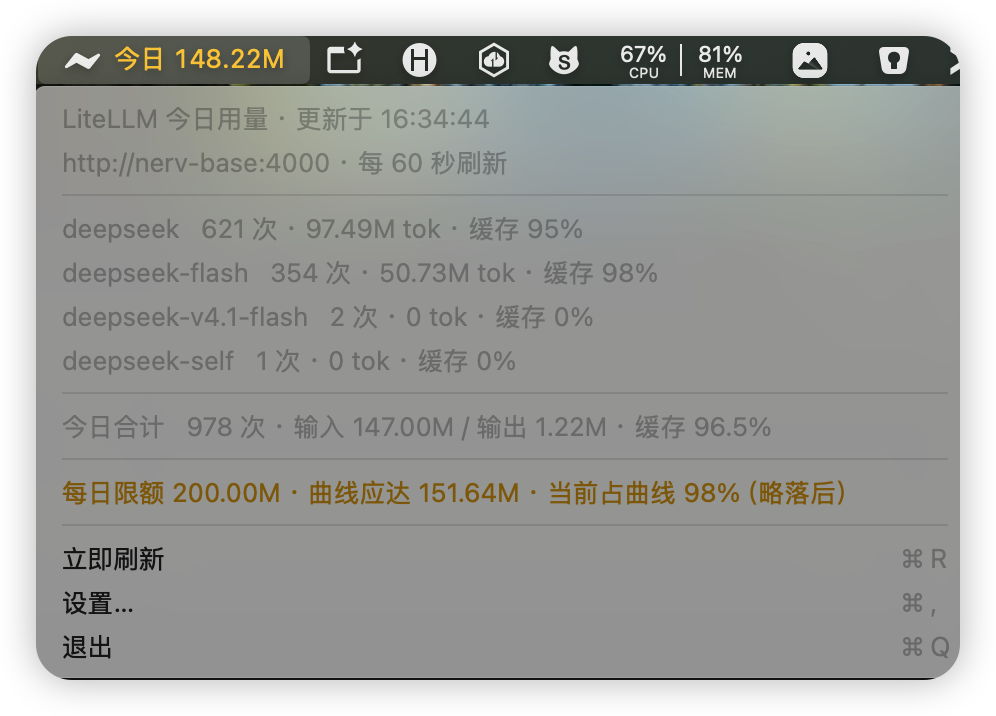

# LiteLLmStats

macOS 菜单栏上的 LiteLLM 用量监控小部件。实时显示**当天** token 消耗，点击展开各模型明细。

<p align="center">
  
</p>

当前版本：**1.0.0**

## 功能

- 菜单栏实时显示「今日 x.xxM」
- 按模型展示请求数、输入/输出 token、缓存命中率
- 模型明细按 token 用量降序排列，用量相同再按请求次数降序
- 可设置每日 token 限额，按 9:00–19:00 线性分配；菜单栏文字颜色随用量相对曲线的位置渐变（落后绿色/黄色，超前橙色/红色）
- 从 LiteLLM 管理 API（数据库汇总）读取当天数据，无需 Prometheus
- 网关地址（IP）与端口可配置
- 刷新间隔可配置（2–3600 秒）
- 访问密钥可配置；留空时自动读取 `~/.litellm/config.yaml` 中的 `master_key`
- 支持开机自动启动（LaunchAgent）
- 当日统计：跨零点自动归零
- 请求超时 15 秒，失败自动重试 3 次
- 查询失败时继续显示本地缓存的今日用量，不清空菜单栏数据

## 数据来源与统计口径

应用调用 LiteLLM 管理 API 获取当天用量。该接口由 LiteLLM 服务端按天汇总数据库中的 spend logs，**不依赖 Prometheus**。

### 管理 API

```text
GET http://<host>:<port>/user/daily/activity
    ?start_date=YYYY-MM-DD
    &end_date=YYYY-MM-DD
    &timezone=-480
    &include_current_utc_day=true
Authorization: Bearer <master_key>
```

- 需要 LiteLLM 设置 `DATABASE_URL` 并开启 spend logs（连接数据库后默认记录）
- 服务端直接按天汇总，无需本地换算
- 按 `model_groups`（配置的模型别名）返回请求数、输入/输出/总 token、缓存读取 token
- 日期按本机时区计算：`timezone` 使用 JavaScript `Date.getTimezoneOffset()` 约定（UTC+8 传 `-480`）
- 数据来自数据库，**不受 litellm 重启影响**，应用当天启动得晚也不会丢已发生的用量

验证（需 `master_key`）：

```bash
curl -H "Authorization: Bearer <master_key>" \
  "http://<host>:<port>/user/daily/activity?start_date=$(date +%F)&end_date=$(date +%F)&timezone=-480"
```

### 前置条件

被监控的 LiteLLM 需要满足：

1. 配置 `DATABASE_URL`，且不要关闭 spend logs（连接数据库后默认记录）；
2. 使用可访问该接口的 `master_key`（虚拟 key 无权限）。

不需要安装或启用 Prometheus，也不需要 `callbacks: ["prometheus"]`。

## 构建

要求：macOS 13+，已安装 Xcode Command Line Tools（提供 `swiftc`）。

```bash
./build.sh
open dist/LiteLLmStats.app
```

产物：`dist/LiteLLmStats.app`（ad-hoc 签名，可直接本地运行）。

## 打包 pkg

```bash
./packaging/build-pkg.sh
```

产物：`dist/LiteLLmStats-1.0.0.pkg`，版本号取自 `Resources/Info.plist` 的 `CFBundleShortVersionString`。

安装包会：

- 安装 `LiteLLmStats.app` 到 `/Applications/LiteLLmStats.app`
- 安装 LaunchAgent 到 `/Library/LaunchAgents/local.llm.litellm-stats.plist`
- 安装后自动为当前登录用户加载开机自启服务
- 清理旧版本 `/Applications/LLMStats.app` 和冲突的用户级 LaunchAgent

双击安装即可。未签名安装包如被 Gatekeeper 拦截，可在「系统设置 → 隐私与安全性」中点击「仍要打开」。

卸载（需要管理员密码）：

```bash
./packaging/uninstall.sh
```

## 配置

点击菜单栏图标 → **设置…**，可修改：

| 项目 | 说明 |
|---|---|
| 网关地址 / IP | LiteLLM 所在主机，默认 `127.0.0.1` |
| 端口 | 默认 `4000` |
| 刷新间隔(秒) | 2–3600，默认 `10` |
| 每日 Token 限制 | 当天 token 总用量上限，默认 `100m`；留空或 `0` 表示不限；支持 `10m` / `500k` 写法 |
| 访问密钥 | 留空则读取 `~/.litellm/config.yaml` 的 `master_key` |
| 开机自动启动 | 写入/启用 LaunchAgent |

### 每日限额曲线

设置限额后，应用把限额按 **9:00–19:00 线性平均分配**，得到当前时刻的“应达用量”（曲线）：

```text
应达用量 = 限额 × (当前时刻 - 9:00) / 10 小时
```

9:00 前应达为 0，19:00 后应达等于限额。用 `实际用量 / 应达用量` 判断进度，菜单栏文字颜色连续渐变：

| 比例 | 状态 | 颜色 |
|---|---|---|
| < 0.8 | 落后 | 绿色 |
| 0.8–1.0 | 略落后 | 黄色 |
| 1.0–1.2 | 超前 | 橙色 |
| > 1.2 | 严重超前 | 红色 |

各区间内保持纯色，分界处（0.8 / 1.0 / 1.2 附近）窄幅渐变过渡。9:00 前若已有用量，视为严重超前（红色）。菜单中“每日限额”一行会同时显示应达用量、当前占曲线比例和状态。

数据目录：`~/.litellmStats/`（权限 0700）。

| 文件 | 说明 |
|---|---|
| `~/.litellmStats/config.json` | 配置（权限 0600），参考 `config.example.json` |
| `~/.litellmStats/usage-cache.json` | 最近一次成功查询的用量（查询失败时展示） |

旧版本使用的 `~/.litellm/menubar/` 数据会在首次启动时自动迁移到新目录。

## 安装与卸载

本仓库只负责构建；可自行将 `dist/LiteLLmStats.app` 复制到 `/Applications`，并在设置中勾选“开机自动启动”。

卸载：

```bash
launchctl bootout gui/$(id -u)/local.llm.litellm-stats 2>/dev/null
sudo rm -rf /Applications/LiteLLmStats.app
sudo rm -f /Library/LaunchAgents/local.llm.litellm-stats.plist
rm -rf ~/.litellmStats ~/.litellm/menubar
```

> 应用使用 `LSUIElement`，只驻留菜单栏，不显示在 Dock 和启动台。

## 开发流程

`main` 分支受保护：**任何人（包括仓库管理员）都不得直接向 `main` commit 或 push，必须从特性分支发起 Pull Request 合并**。

任何修改（包括文档、注释、版本号）都必须执行：

1. 从最新 `main` 创建 `feature-x.y.z` 分支；
2. 在特性分支提交并 `push` 到 GitHub；
3. 发起 PR 合并到 `main`。

分支命名统一为 `feature-x.y.z`，版本号按改动类型递增：

| 改动类型 | 版本变化 | 示例（当前 `1.0.0`） |
|---|---|---|
| 大功能 | 递增 `x` | `feature-2.0.0` |
| 小功能更新 | 递增 `y` | `feature-1.1.0` |
| 缺陷修复 | 递增 `z` | `feature-1.0.1` |

```bash
git checkout main
git pull
git checkout -b feature-1.1.0

# 修改代码并提交
git add -A
git commit -m "feat: your feature"

git push -u origin feature-1.1.0
# 在 GitHub 创建 Pull Request，合并到 main
```

## 发布

1. 修改 `Resources/Info.plist` 中的版本号（`CFBundleShortVersionString` / `CFBundleVersion`）
2. 执行 `./packaging/build-pkg.sh`
3. 在 GitHub Releases 新建 `v<版本号>` tag，上传 `dist/LiteLLmStats-<版本号>.pkg`

当前版本 `1.0.0` 的安装包：`LiteLLmStats-1.0.0.pkg`。

## 版本

- `1.0.0` — 当天用量改为完全由 LiteLLM 管理 API（数据库按天汇总）提供，移除 Prometheus 回退；新增本地用量缓存；模型明细按用量排序；新增每日 token 限额与 9:00–19:00 进度曲线配色
- `0.3.0` — 指标查询超时调整为 15 秒、失败自动重试 3 次；查询失败时继续显示本地缓存的今日用量
- `0.2.0` — 数据目录迁移到 `~/.litellmStats`（自动迁移旧数据）；README 补充 Prometheus 前置条件与分支命名规范
- `0.1.0` — 首个对外版本：菜单栏今日用量、按模型明细、可配置网关/刷新/密钥、开机自启
